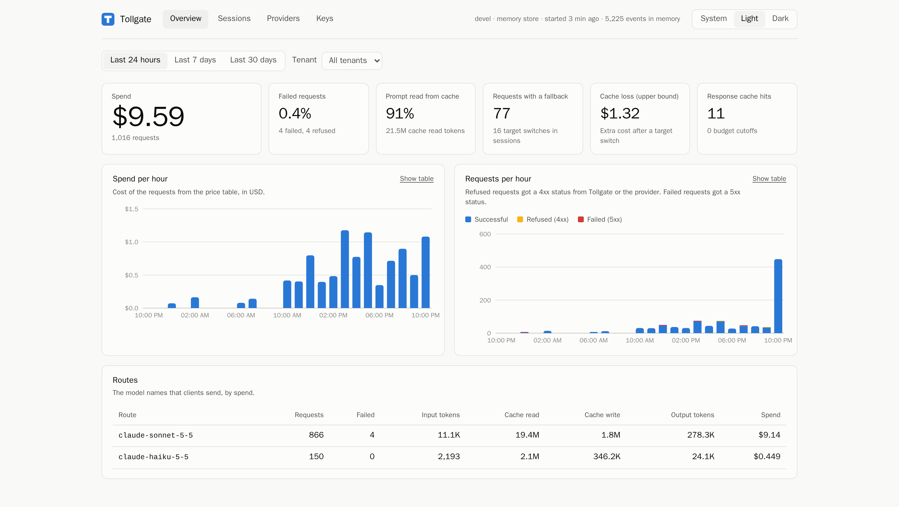

# Hi, I'm Yash

I'm a software engineer at [First Solar](https://www.firstsolar.com/). Outside of work, I build tools for AI coding agents. I write the backends in **Go** and the interfaces in **React** and **TypeScript**.

I also send fixes and features to open-source coding agents, such as OpenHands, Kilo Code, and Crush.

[yashkakade.com](https://yashkakade.com) · [LinkedIn](https://www.linkedin.com/in/yashkakade/) · [X](https://x.com/Yash_2015)

## Tollgate

**A self-hosted AI gateway for coding agents.** &nbsp;`Go` `React` `TypeScript`

<a href="https://github.com/ykakade/tollgate">
  <picture>
    <source media="(prefers-color-scheme: dark)" srcset="assets/tollgate-dashboard-dark.png">
    
  </picture>
</a>

One task from a coding agent can send hundreds of large requests, and nobody watches the meter. Tollgate sits between the agent and the Anthropic or OpenAI API. It gives each session a hard budget, fails over when a provider goes down, and puts a price on every request. The agent needs no code changes, only two environment variables.

- **Streaming proxy in Go.** Streams pass through byte for byte. If a provider fails before the first byte, Tollgate sends the request to the next target. Circuit breakers and a retry budget stop retry storms.
- **Budgets that hold.** Tollgate reserves the estimated cost before it sends a request. Then it settles the real cost from the usage report. Replicas share limits through Redis, with Lua scripts for atomic updates.
- **React dashboard in the binary.** I built it with React 19, TypeScript, and Vite. The Go binary embeds the build, so you deploy one file.
- **Checked on every push.** CI runs about 250 tests with the race detector, 4 fuzz targets, lint, and a vulnerability scan.
- **Ready to operate.** Prometheus metrics, OpenTelemetry traces, signed releases, and 34 design records that explain the trade-offs.

[Repository](https://github.com/ykakade/tollgate) · [Documentation](https://ykakade.github.io/tollgate/) · [Watch the 81-second tour](https://ykakade.github.io/tollgate/#see-it-work)

## Other projects

**[ui-grab](https://github.com/ykakade/ui-grab)** &nbsp;`JavaScript` `Vite` 
Click elements in your running app, write what should change, and send the batch to Claude Code. Each item arrives with its source file and line. After the edit, ui-grab measures the elements again and tells you which ones actually changed. It is a Vite plugin with zero runtime dependencies, and it also works with Next.js. 
[Try the picker →](https://ykakade.github.io/ui-grab/)

**[Flappy Fly](https://github.com/ykakade/flappy-fly-connectome)** &nbsp;`Python` `PyTorch` `JavaScript` 
Can a controller wired like a real fruit-fly brain learn a Flappy Bird-style game? I took 96 neurons and 602 connections from the MaleCNS connectome and trained them with PPO. The score went from 0 to 16.9 gates on unseen levels. A shuffled graph did a little better, and the README says so. Inference runs in the browser in plain JavaScript. 
[Play it →](https://flappy-fly-connectome.pox.chatgpt.site)

## Open source

I fix bugs and add features in open-source AI tools. Some recent pull requests:

**Go**

| Project | What I changed | Status |
| :-- | :-- | :-- |
| [oras-go](https://github.com/oras-project/oras-go) OCI registry client · CNCF | Fixed sign-in after a same-host redirect from HTTP to HTTPS. Credentials from the upgrade are not cached, so they cannot leak over HTTP later. | **[Merged](https://github.com/oras-project/oras-go/pull/1663)** |
| [Crush](https://github.com/charmbracelet/crush) Charm's terminal agent · 29k ★ | Kept Windows named pipes such as `\\.\pipe\name` intact in MCP and LSP arguments. | [Open](https://github.com/charmbracelet/crush/pull/4121) |
| [go-openai](https://github.com/sashabaranov/go-openai) OpenAI client for Go · 11k ★ | Added generic types for Batch API result files, and `maxLength` in JSON Schema. | [Open](https://github.com/sashabaranov/go-openai/pulls?q=is%3Apr+author%3Aykakade) |
| [Bifrost](https://github.com/maximhq/bifrost) AI gateway · 9k ★ | Fixed MCP config edits that a restart ignored, and kept web search status in Responses conversion. | [Open](https://github.com/maximhq/bifrost/pulls?q=is%3Apr+author%3Aykakade) |

**TypeScript and React**

| Project | What I changed | Status |
| :-- | :-- | :-- |
| [Kilo Code](https://github.com/Kilo-Org/kilocode) VS Code agent · SolidJS · 28k ★ | Found a process-wide cache bug in `gray-matter` that dropped project skills. Fixed the Grep target path in chat. | **[2 merged](https://github.com/Kilo-Org/kilocode/pulls?q=is%3Apr+author%3Aykakade+is%3Amerged)**, [10 in review](https://github.com/Kilo-Org/kilocode/pulls?q=is%3Apr+author%3Aykakade+is%3Aopen) |
| [OpenHands](https://github.com/OpenHands/OpenHands) AI software agent · React · 92k ★ | Added an Enhance Prompt preview to the chat composer, and token usage for each type of agent activity. | [In review](https://github.com/OpenHands/OpenHands/pulls?q=is%3Apr+author%3Aykakade) |
| [Orca](https://github.com/stablyai/orca) Agent workspace app · React · 107k ★ | Added four features to workspace cards, the sidebar, and the dashboard. | [Open](https://github.com/stablyai/orca/pulls?q=is%3Apr+author%3Aykakade+is%3Aopen) |
| [Eclipse Theia](https://github.com/eclipse-theia/theia) IDE framework · 22k ★ | Added file navigation, change navigation, and collapse all to the multi-diff editor. | [Open](https://github.com/eclipse-theia/theia/pull/18226) |

Also merged: a memory-leak fix in [BeeAI Framework](https://github.com/i-am-bee/beeai-framework/pull/1820), an LF AI & Data project. The root emitter kept every tool that ever ran. Now each parent holds only a weak reference to its children.

## Tools I use

**Go:** HTTP and streaming proxies, concurrency, Redis, Prometheus, OpenTelemetry, fuzz tests 
**React and TypeScript:** React 19, Vite, Electron, VS Code webviews, Storybook 
**JavaScript:** Node.js, Vite plugins, browser APIs, Chrome extensions 
**Also:** Python, PyTorch, SolidJS, Docker, GitHub Actions

---

Away from the keyboard, I take photographs, get distracted by cats, and keep adding places to my Japan trip.
